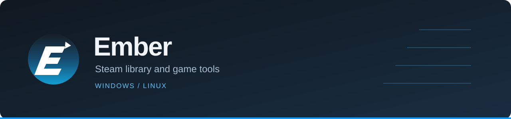
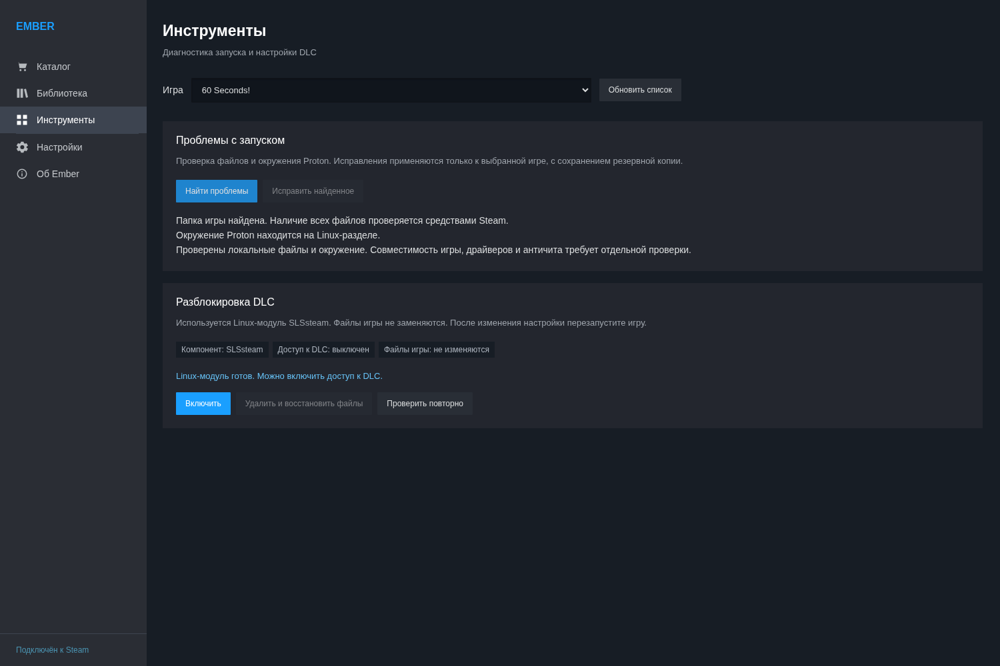

<p align="center"></p>

<p align="center">
  <a href="https://github.com/Ch3L1k/Ember/releases">Downloads</a> ·
  <a href="docs/INSTALL.md">Installation</a> ·
  <a href="https://github.com/Ch3L1k/Ember/issues">Report a bug</a> ·
  <a href="docs/README.ru.md">Русский</a>
</p>

Ember puts a game catalog, library tools and launch diagnostics inside Steam. Open it from the Steam menu or from a game's store page. Millennium is optional.

**Preview software.** Windows and Linux use the same interface, with different platform components. Compatibility depends on the game, Steam version and configured data source.

## What it does

- **Catalog:** search by title or App ID, save games for later and revisit recent additions. Text search uses a local index; remote metadata loads separately.
- **Library:** register games in the local Steam client, then install and launch them from Steam. Removing an Ember registration keeps game files and saves, with an option to restore it.
- **DLC tools:** manage supported unlocker configurations for individual games.
- **Launch diagnostics on Linux:** inspect installation paths, mount restrictions and Proton prefixes. Supported repairs move a prefix to a Linux filesystem and retain the original as a backup.
- **Steam integration:** an embedded page, a store-page button, progress feedback and Russian/English UI.

Registration does not add a license to your Steam account. Games with additional DRM, server-side ownership checks or unsupported anti-cheat may not work. DLC may require separate content files.

<details>
<summary><b>Screenshot — Linux launch diagnostics</b></summary>



</details>

## Install

| Platform | Package | Start here |
| --- | --- | --- |
| Windows 10/11, x64 | `Ember-Setup.exe` | Run the installer as your normal user. |
| Linux, x86_64 | `Ember-Source.zip` | Extract it and run `bash install.sh`. |

Get the files from [Releases](https://github.com/Ch3L1k/Ember/releases). The Linux installer runs entirely in the terminal: install/update, dependency check and uninstall. Python 3.11+ and internet access are required. Do not run it with `sudo`.

Start the terminal installer with one command:

```sh
bash <(curl -fsSL https://raw.githubusercontent.com/Ch3L1k/Ember/main/install-online.sh)
```

Or download the archive and install locally:

```sh
unzip Ember-Source.zip
cd Ember
bash install.sh
```

The installers set up Ember. Game registration needs compatible external components: LumaCore on Windows; SLSsteam and lumalinux on Linux. Some data sources require an API key. See [installation and removal](docs/INSTALL.md) for details.

## Compatibility

| Environment | Status |
| --- | --- |
| Windows 10/11 x64 | Installer built on Windows; game compatibility varies. |
| Arch-based Linux, native Steam | Primary Linux development environment; tested with Hyprland. |
| Other Linux distributions | Not yet covered by the same desktop testing. |
| Flatpak Steam / Steam Deck | Not verified for this release. |

Steam updates can change its UI and break integration. Diagnostics do not repair every possible launch failure. Driver problems, missing runtimes, incomplete downloads and game-specific crashes still need separate investigation.

## Development

The application is Python with a web UI. Windows packaging uses PyInstaller and NSIS; Linux uses a per-user virtual environment.

[Build and setup instructions](docs/INSTALL.md#development) · [Changelog](CHANGELOG.md)

For a bug report, include your OS, Ember version, Steam installation type and the steps to reproduce it. For launch problems, include the game's App ID and the exact error. Remove tokens and personal information from logs before attaching them.

## Credits

Maintained by [Ch3L1k](https://github.com/Ch3L1k). Based on [SteaMidra / SFF](https://github.com/drappula/SFF/tree/v6.9.1) by Midrag and contributors.

GPL-3.0-or-later. See [LICENSE](LICENSE), [third-party notices](THIRD-PARTY.txt) and [upstream attribution](EMBER-NOTICES.txt). Third-party components keep their own licenses.

Ember is a community project and is not affiliated with Valve.
