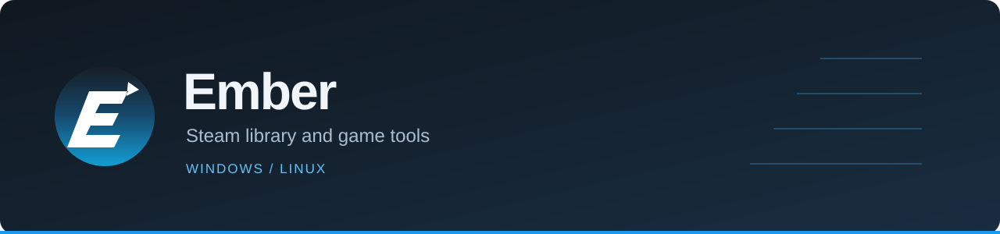
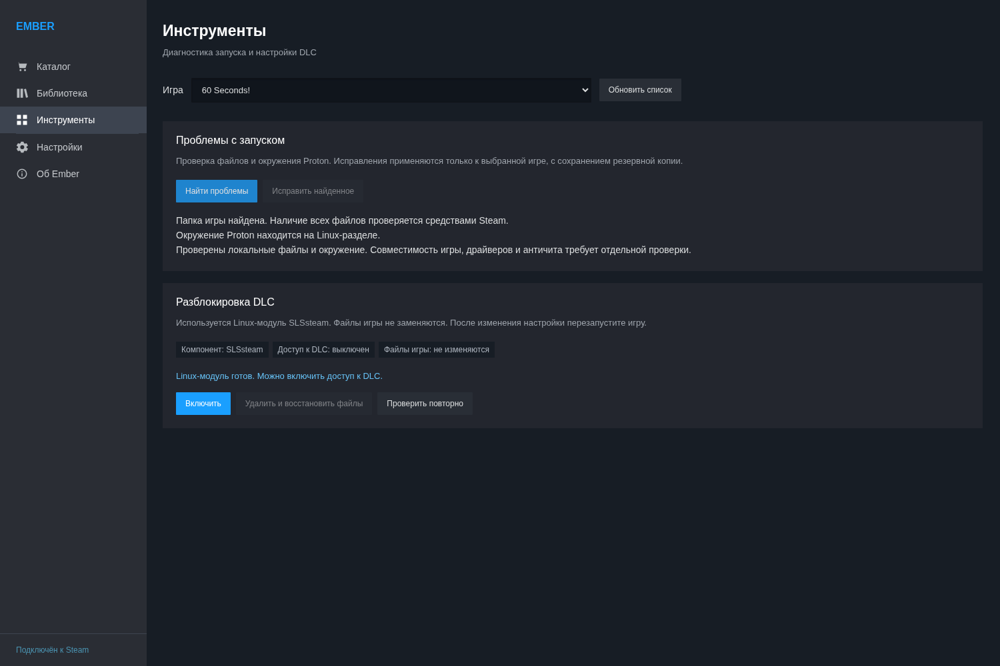

<p align="center"></p>

<p align="center"><a href="https://github.com/Ch3L1k/Ember/releases">Скачать</a> · <a href="INSTALL.md">Установка</a> · <a href="https://github.com/Ch3L1k/Ember/issues">Сообщить об ошибке</a> · <a href="../README.md">English</a></p>

Ember добавляет в Steam каталог игр, инструменты библиотеки и диагностику запуска. Открывается из меню Steam или со страницы игры в магазине. Millennium необязателен.

**Предварительная версия.** Интерфейс общий для Windows и Linux, системные компоненты отличаются. Совместимость зависит от игры, версии Steam и источника данных.

## Возможности

- Поиск по названию и App ID, отложенные игры и история добавлений. Поиск сначала использует локальный индекс, затем получает дополнительные данные из сети.
- Регистрация игр в библиотеке клиента Steam. Скачивание и запуск — через Steam. Удаление регистрации Ember сохраняет файлы игры и сохранения; регистрацию можно восстановить.
- Настройка поддерживаемых инструментов разблокировки DLC для отдельных игр.
- Диагностика запуска на Linux: папки, ограничения файловой системы и окружение Proton. Поддерживаемое исправление переносит префикс на Linux-раздел, сохраняя исходную копию.
- Страница внутри Steam, кнопка в магазине, индикаторы операций и русский/английский интерфейс.

Регистрация не добавляет лицензию на Steam-аккаунт. Дополнительная DRM, серверная проверка владения и несовместимый античит могут препятствовать запуску. Для DLC иногда нужны отдельные файлы.

<details><summary><b>Скриншот — диагностика запуска на Linux</b></summary>



</details>

## Установка

В [релизах](https://github.com/Ch3L1k/Ember/releases):

- **Windows 10/11 x64:** `Ember-Setup.exe`. Запустите от обычного пользователя.
- **Linux x86_64:** распакуйте `Ember-Source.zip` и запустите `bash install.sh` из папки `Ember`. Нужны Python 3.11+ и интернет. `sudo` не требуется.

Запуск установщика одной командой:

```sh
bash -c 'bash <(curl -fsSL https://raw.githubusercontent.com/Ch3L1k/Ember/main/install-online.sh)'
```

Или скачайте архив из релизов, распакуйте и выполните `bash install.sh`. Онлайн-установщик проверяет SHA-256 архива до запуска.

В терминальном установщике Linux есть установка/обновление, проверка зависимостей и удаление. Настройки, игры и сохранения при удалении остаются.

Установщики устанавливают Ember. Для регистрации игр отдельно нужны совместимые компоненты: LumaCore на Windows, SLSsteam и lumalinux на Linux. Некоторые источники требуют API-ключ. [Подробности](INSTALL.md).

## Совместимость

Linux-интеграция проверялась на Arch-based Linux с Hyprland и обычным Steam. Flatpak, Steam Deck и другие окружения пока не прошли такую же проверку. Windows-установщик собирается на Windows; совместимость конкретных игр различается.

Обновление Steam может потребовать исправления интеграции. Диагностика не решает все причины сбоя: драйверы, недостающие библиотеки, неполная загрузка файлов и ошибки самой игры проверяются отдельно.

## Ошибки и разработка

В отчёте укажите ОС, версию Ember, способ установки Steam и шаги воспроизведения. Для проблем запуска добавьте App ID игры и точный текст ошибки. Перед отправкой журнала удалите токены и личные данные.

[Настройка среды и сборка](INSTALL.md#development) · [История изменений](../CHANGELOG.md)

## Авторы

Проект [Ch3L1k](https://github.com/Ch3L1k), основан на [SteaMidra / SFF](https://github.com/drappula/SFF/tree/v6.9.1) от Midrag и участников проекта.

GPL-3.0-or-later: [лицензия](../LICENSE), [сторонние компоненты](../THIRD-PARTY.txt), [происхождение](../EMBER-NOTICES.txt). Ember не связан с Valve.
